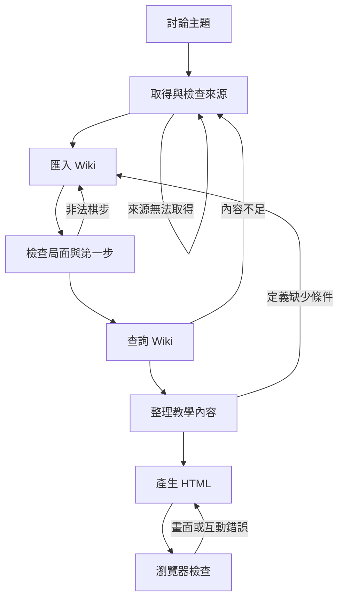

# 棋盤筆記：LLM Wiki 與教學 HTML 簡報

本專案為「用 LLM Wiki 做一份教學 HTML 簡報」作業。2026 年 11 月 22 日先討論主題，再由使用者選擇西洋棋戰術，接著閱讀五篇文章並整理成 Wiki。

## 成果

- `docs/index.html` 是可搜尋的 Wiki 首頁。
- `docs/wiki.html?topic=fork` 是一篇 Wiki 筆記，包含自製棋局、來源與相關筆記。
- `docs/slides.html` 是 12 頁教學 HTML 簡報，可用按鈕與方向鍵換頁。
- `docs/sources.html` 提供五篇來源摘要和原文。
- `docs/workflow.html` 提供流程、檢查紀錄與反思。
- `SUBMISSION.md` 提供中文繳交草稿。

## 重現

```sh
python -m pip install -r requirements.txt
python scripts/workflow.py
python scripts/workflow.py --query "閃擊 閃將"
python -m http.server 8000 --directory docs
```

開啟 `http://localhost:8000/`。一般訪客可直接開 HTML，免安裝套件。重建資料時需要 Python 與 python-chess。

此 Wiki 由 LLM 輔助閱讀、整理與撰寫。來源摘要與筆記均落地成檔案。關鍵字檢索、棋局驗證和網頁生成由程式執行。網站使用靜態資料，瀏覽時可搜尋既有筆記。來源內容用自己的文字摘要，保留原文連結。棋局是本專案自製。

## 檔案與追溯

`sources/articles.json` 的來源編號對應 `sources/S01.md` 至 `S05.md`。`wiki/notes.json` 經匯入後，產生 `wiki/entries/` 筆記。五個實際檢索輸出位於 `runs/retrieval.json`。`runs/validation.json` 記錄執行時間、輸入雜湊、五個局面及合法棋步檢查。`runs/issues.json` 與 `runs/first-error.txt` 保留兩個實際問題。

## 流程



## 發布

可將完整專案上傳到新的 GitHub repository，設定 GitHub Pages 使用 `main` 分支的 `/docs`。保留 `docs/.nojekyll`。目前 ChatGPT Sites 的發布設定位於 `.openai/hosting.json`，其中使用打包後的 `dist/`。要搬到新 Sites 專案時，使用該專案的新身分設定。
